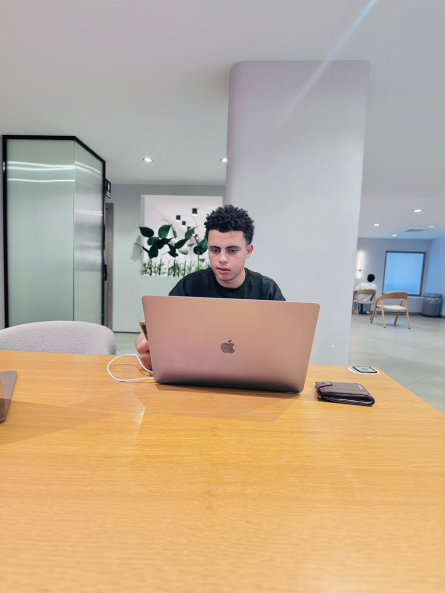

<div align="center">




<a href="https://git.io/typing-svg"></a>

<br/>

<a href="mailto:aldalybdh327@gmail.com"></a>
<a href="https://www.linkedin.com/in/abdou-samy-181433450/"></a>
<a href="https://codeforces.com"></a>
<a href="https://www.instagram.com/abdou_aldaly"></a>

</div>

<br/>

```bash
abdo@dev:~$ whoami
Computer Science student and full-stack developer, Django + React/Next.js.
Building two production platforms end to end: an LMS and a marketplace.

abdo@dev:~$ cat currently_learning.txt
Offensive security fundamentals: Kali Linux, Burp Suite, Wireshark.

abdo@dev:~$ cat status.txt
Open to collaboration on serious, long-term projects. Available for freelance work.
```

<br/>

## About

I build complete systems, from database schema to deployed UI. Most of my time goes into two platforms I'm taking from architecture to production, alongside daily practice in competitive programming and a growing focus on how systems get attacked, which keeps shaping how I design them.

| | |
|---|---|
| 🏗️ **Building** | **Abdou Samy Academy**, an LMS with video streaming, payments, and certification |
| 🛒 **Building** | **JOX-STORE**, a real-time digital marketplace with seller dashboards |
| 🧩 **Practicing** | Algorithmic problem-solving on Codeforces |
| 🛡️ **Studying** | Penetration testing with Kali Linux, Burp Suite, and Wireshark |
| 🤖 **Also** | Telegram bots on FSM-based conversation logic, and 3D web experiences with Three.js |

<br/>

## Projects

<table>
<tr>
<td width="50%" valign="top">

### 🎓 [Abdou Samy Academy](https://github.com/JOXSERVICE)
Full LMS with video streaming, analytics, payment integration, and automated certification.


</td>
<td width="50%" valign="top">

### 🛍️ [JOX-STORE](https://github.com/JOXSERVICE)
Real-time digital marketplace with seller dashboards, live notifications, and order management.


</td>
</tr>
<tr>
<td width="50%" valign="top">

### 🤖 [Telegram Bot Suite](https://github.com/JOXSERVICE)
Bots built on finite-state-machine logic, webhook architecture, and admin panels.


</td>
<td width="50%" valign="top">

### 🌌 [3D Interactive Portfolio](https://github.com/JOXSERVICE)
WebGL experience with custom particle systems and scroll-driven animation.


</td>
</tr>
</table>

<br/>

## Stack

<div align="center">


</div>

| Layer | Tools |
|---|---|
| **Languages** | Python, JavaScript, TypeScript |
| **Backend** | Django, Django REST Framework, Spring Boot, Celery |
| **Frontend** | React, Next.js, Tailwind CSS, Three.js, GSAP |
| **Data & Infra** | PostgreSQL, Redis, Docker, Nginx, Linux |
| **Security** | Kali Linux, Burp Suite, Wireshark |

<br/>

## GitHub

<div align="center">


</div>

<br/>

<div align="center">


Open to collaboration on serious, long-term projects · Available for freelance work · Usually responds within 24 hours

</div>
